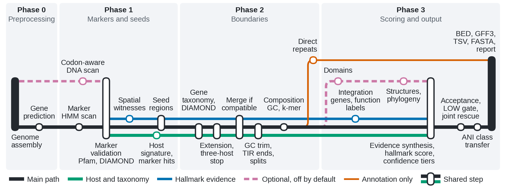

# ViroSync


[](LICENSE)

ViroSync finds candidate endogenous viral elements (EVEs) in assembled
eukaryotic genomes. It detects viral markers, refines boundaries, and provides
accepted regions with their evidence.

## Workflow



Confirmed marker-bearing gene cores remain inside candidates as boundaries change.
With default settings, an exterior gene counts as host when its host-lineage share
is at least 0.35 and it has no viral evidence. Viral evidence is a validated viral
marker, or a viral hit with at least 25% identity in the top 10 or within the first
`phase2.viral_hit_depth` hits. Three host genes stop extension before the first of
them. A gene with viral evidence between them resets the count. Other genes, including
genes that only foreign or machine-learning evidence supports, do not, so the three
need not be adjacent. The walk may continue past the three when at least two of the next
five walk entries after the third have a viral match (a validated viral marker or a top-10 viral
hit), counting only genes before the first gene without a taxonomy record. Foreign,
marker-set and machine-learning support do not count. Inside the seed envelope, searched
no-hit genes without marker-set membership, a qualifying viral veto, or ML support are
skipped; outside it they take a place in the window. The stop stays unless the walk then
accepts a supporting gene beyond the three. A validated viral marker or a top-10 viral hit supports extension
at any host share.

ViroSync runs on CPUs by default. A GPU is not required for the core workflow.
The default environment includes the tools for notebook reports and figures.
Plotting is off by default; use `--plots` to render the notebook during a run.
Scientific tables, sequences, evidence, and audit outputs are produced in either mode.
Development tools, masking, machine-learning taxonomy, and structural analysis
use [separate environments](docs/getting-started.md#environments).

## Install ViroSync

ViroSync supports Linux x86-64 and uses [Pixi](https://pixi.sh/).

```bash
git clone https://github.com/NeLLi-team/virosync.git
cd virosync
pixi install --locked
pixi run setup-prodigal-gv
pixi run setup-virosync-resources
```

Resources download about 11.6 GB, use about 25.7 GB when installed, and need about
37.3 GB during setup. Allow more space for the Pixi environment and results.
Native setup builds the pinned Prodigal-GV capacity correction. The
[installation guide](docs/getting-started.md) covers its runtime directory and
direct Python or console use.

## Quick start

```bash
pixi run example
cat results/example/batch_summary.tsv
```

With resource bundle v1.3.0, the `test-1` row reports `status=success`,
`predictions=17`, and `accepted=4`.

## Run your own genomes

```bash
pixi run virosync \
  -i genomes/ \
  -o results/my_run \
  --config config/orchestration.yaml \
  -w 3 \
  --threads-per-worker 16
```

`-i` accepts one uncompressed `.fna`, `.fasta`, or `.fa` file, a directory of
these files, or a text file with one FASTA path per line.

The output root contains `batch_summary.tsv` with status and counts for each
genome. Each genome directory contains:

- `phase3_synthesis/virosync_predictions.tsv`: accepted EVE calls.
- `phase3_synthesis/virosync_predictions.gff3`: accepted EVE coordinates and annotations.
- `virosync_predictions_detailed.tsv`: all candidates and their evidence.
- `virosync_repeat_candidates.tsv`: same-orientation repeat pairs linked to the
  detailed candidates, including rejected candidates.

Direct-repeat assessment runs by default and annotates evidence without changing
accepted boundaries or confidence tiers. See [Outputs](docs/METHODS.md) for the
repeat fields and the root-level output layout of runs that end before Phase 3.

Frameshift-sensitive marker detection is off by default. Add
`--frameshift-screening` to enable it. See the
[frameshift screening guide](docs/FRAMESHIFT_SCREENING.md) for usage and limits.

See the [documentation](https://nelli-team.github.io/virosync/) for output
details, command options, and optional analyses.

ViroSync 1.3.0 uses resource bundle v1.3.0.

ViroSync is available for non-commercial use under [LICENSE](LICENSE).
